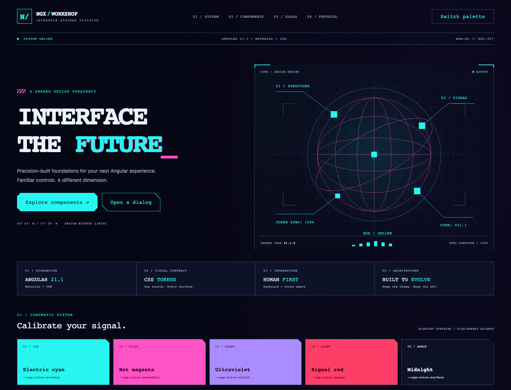

# ngx-workshop-design-system

Angular **21.1.0** · Material/CDK **21.1.0** · Storybook **10.6.3**

The shared visual foundation for Ngx Workshop: midnight surfaces, electric cyan, magenta and signal red, angular HUD frames, technical typography and original wireframe details.

```sh
npm ci
npm run storybook
```

Open http://localhost:6006. Start with **Start here → Workshop frequency → Overview**.
Explore **Material → Catalog → Overview** for the searchable index of all 36 installed Material UI families, with 92 new state stories and working interactions. See the [coverage matrix](docs/material-coverage.md).
The toolbar switches Neon and Neutral themes, including Material overlays.
`npm start` runs the same showcase as a standalone Angular application on port 4200.



## Workspace

| Project                    | Purpose                                               |
| -------------------------- | ----------------------------------------------------- |
| `projects/ngx-workshop-ui` | Packaged `@ngx-workshop/ui` library and Sass theme    |
| `projects/storybook`       | Storybook catalog and standalone showcase application |

Included: token/typography foundations, Material buttons, form fields, selects, checkboxes, toggles, tabs, progress and dialogs; shared `NgxPanel`, `NgxStatus` and `NgxCodeBlock`.
Material controls keep their native APIs. Shared visual treatment uses public Sass override mixins; no private DOM selectors.

## Consume locally

```sh
npm run build
# In an Angular 21.1.0 consuming app:
npm install /absolute/path/to/ngx-workshop-design-system/dist/ngx-workshop-ui
```

Global `styles.scss`:

```scss
@use '@ngx-workshop/ui/theme' as ngx;
@include ngx.theme();
```

Standalone component:

```ts
import { NgxPanel, NgxStatus, NgxCodeBlock } from '@ngx-workshop/ui';
// Add these to your component's imports array.
```

```html
<ngx-panel heading="Angular signals" eyebrow="Next workshop">
  <p>Build something reactive.</p>
  <ngx-status label="Registration open" tone="success" />
</ngx-panel>
<ngx-code-block code="npm run build" />
```

Override semantic CSS variables to introduce another palette. Use `data-ngx-theme="neutral"` on `<html>` for the included alternative. See [tokens](docs/tokens.md).

## Workflow and checks

This is a lightweight Markdown adaptation of GitHub Spec Kit, with no Spec Kit CLI dependency.
Read [AGENTS.md](AGENTS.md), the [workflow](.specify/README.md), [constitution](.specify/memory/constitution.md) and [feature index](specs/README.md).
See [development](docs/development.md) for checks and [architecture](docs/architecture.md) for boundaries.
No deployment or remote repository is configured.

Panel variants: [shape, surface and transition guide](docs/panels.md). Use the Storybook panel transition lab to replay boot, glitch and hologram intro/outro sequences.

Button variants: [shape, surface and interaction guide](docs/buttons.md). Apply `NgxButton` beside `mat-flat-button` and explore **Components → Button → Interaction lab** for hover, keyboard-focus and click effects.

Code blocks: [Synthwave ’84 usage and tokens](docs/code.md). Native `<pre><code>` and `NgxCodeBlock` share the code palette; optional languages load standalone parsers. Compare the lightweight renderer with the actual editor under **Components → Code block → CodeMirror parity**.

Overlay depth: [glass backdrops](docs/overlays.md) are shared across CDK-backed dialogs, sheets and popup backdrops. Workshop Frequency includes an interactive glass/solid/grid preview and live overlay actions.
