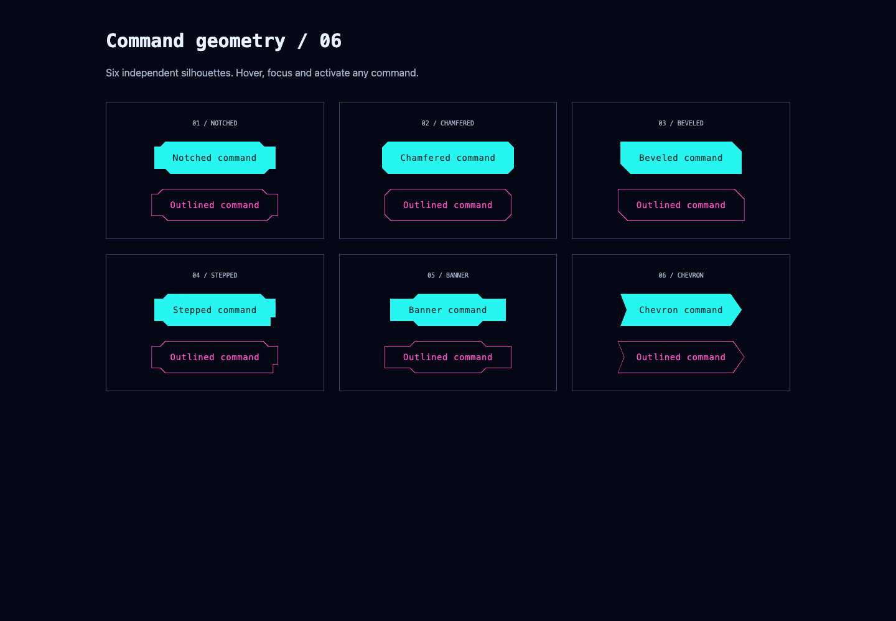
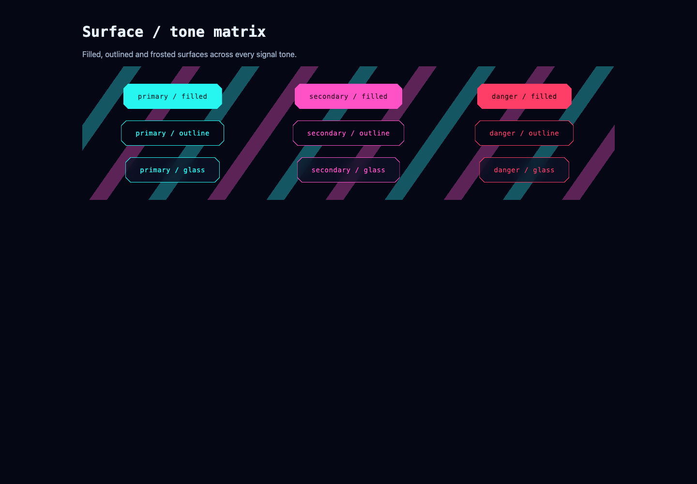

# Angular buttons and interaction motion

`NgxButton` is a standalone visual directive applied alongside a normal Material button on the same native `<button>` or `<a>`. It adds shapes, surfaces and motion; Material and the browser retain the control's semantics.

```ts
import { MatButtonModule } from '@angular/material/button';
import { NgxButton } from '@ngx-workshop/ui';
// Include both in your standalone component imports.
```

Include the shared theme once in global Sass:

```scss
@use '@ngx-workshop/ui/theme' as ngx;
@include ngx.theme();
```

```html
<button
  mat-flat-button
  ngxButton
  type="button"
  shape="stepped"
  surface="filled"
  tone="primary"
  motion="glitch"
  (click)="launchWorkshop()"
>
  Launch workshop
</button>
```

| Input     | Values                                                            | Default   |
| --------- | ----------------------------------------------------------------- | --------- |
| `shape`   | `notched`, `chamfered`, `beveled`, `stepped`, `banner`, `chevron` | `notched` |
| `surface` | `filled`, `outline`, `glass`                                      | `filled`  |
| `tone`    | `primary`, `secondary`, `danger`                                  | `primary` |
| `motion`  | `scan`, `glitch`, `pulse`, `none`                                 | `scan`    |

The directive requires Material's `MatButton` on the same host. The examples use `mat-flat-button`; projected icons are supported. MatIconButton, FAB and button-toggle are distinct Material controls and are not hosts for this directive.
The visual silhouette is decorative. The native rectangular hit area and visible focus ring stay intact. Labels, icons, ripples and other Material-owned elements are not queried or replaced.

## Interaction

- **Scan:** a single light sweep on hover or keyboard focus; a short compression/release on activation.
- **Glitch:** bounded, stepped position/skew offsets on hover/focus and activation; no opacity strobe or repeating loop.
- **Pulse:** hover lift/glow, a visible keyboard focus ring and a short compression/expansion pulse on activation.
- **None:** static hover/focus feedback without the decorative sequences or press transform.

Hover sequences run only on devices that support hover. Activation listens to the actual native click event, so Enter/Space on a button do not produce duplicate application events. Anchors keep native Enter behavior; Space is not remapped to activate links.
Repeated activations cancel the previous press effect and start one new sequence. Effects clean up when the directive is destroyed.
Reduced-motion preference disables CSS sequences and skips Web Animations press effects, while preserving the visible focus indication and all interactions.

## Disabled, busy, links and forms

Use Material's existing `disabled` input, native `type`, `href` and `aria-busy`. There is no separate Ngx disabled model or synthetic activation output.

```html
<button mat-flat-button ngxButton [disabled]="saving()" [attr.aria-busy]="saving()">
  {{ saving() ? 'Saving…' : 'Save workshop' }}
</button>

<button mat-flat-button ngxButton type="submit" surface="outline">Submit configuration</button>
```

Disabled buttons do not activate; the Ngx motion handler also checks Material's disabled state. For disabled anchors, Material prevents navigation and removes normal keyboard access. Guard application click side effects explicitly against the same disabled state: an anchor has no native disabled attribute, and Angular's host handler may run before Material's navigation guard.

```html
<a
  mat-flat-button
  ngxButton
  href="/resources"
  [disabled]="unavailable()"
  (click)="!unavailable() && recordResourceOpen()"
>
  Open resources
</a>
```

The directive does not prevent default events, stop propagation, change form semantics or remove link destinations. Consumers own business side effects and loading state.

## Surfaces and tokens

Filled buttons use a real colored decorative element behind the label; outline/glass use hollow polygon strokes. Glass has a translucent surface and actual backdrop blur with an opaque fallback for unsupported browsers or reduced-transparency preference. Only decoration is clipped; backdrop filtering is not trapped under a clipped ancestor.
The stroke and fill share one Sass vertex map. Colors come from the paired semantic primary/on-primary, secondary/on-secondary and danger/on-danger tokens. A consumer's glass backdrop still needs a contrast check.

| Token                         | Default | Purpose                                                           |
| ----------------------------- | ------- | ----------------------------------------------------------------- |
| `--ngx-button-cut`            | `10px`  | Chamfered corner cut                                              |
| `--ngx-button-hover-duration` | `180ms` | Hover glow/lift transition                                        |
| `--ngx-button-scan-duration`  | `480ms` | One-pass scan duration                                            |
| `--ngx-button-press-duration` | `300ms` | Native activation sequence, CSS time in ms/s, clamped to 0–1200ms |
| `--ngx-button-blur`           | `12px`  | Glass backdrop blur                                               |

Override tokens on the root or one control. Reduced-motion preference takes precedence. The theme exports `button-styles()` for custom theme compositions; `theme()` already includes it.
Existing `.ngx-action` classes remain compatible and are not automatically upgraded or removed. Use the directive for the new variants.

Storybook: **Components → Button → Interaction lab**, including shape/surface comparisons, disabled/loading specimens and a live activation readout. The standard Material button catalog also includes a shared Ngx button example.




