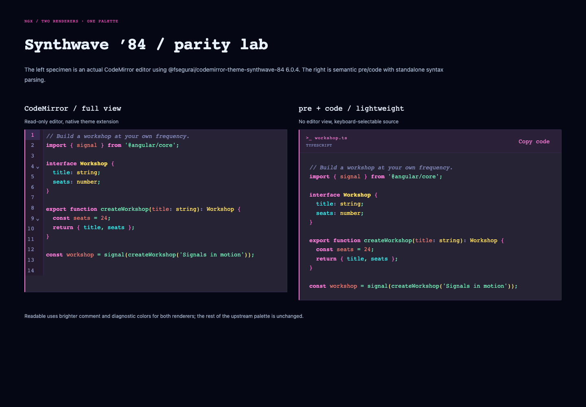
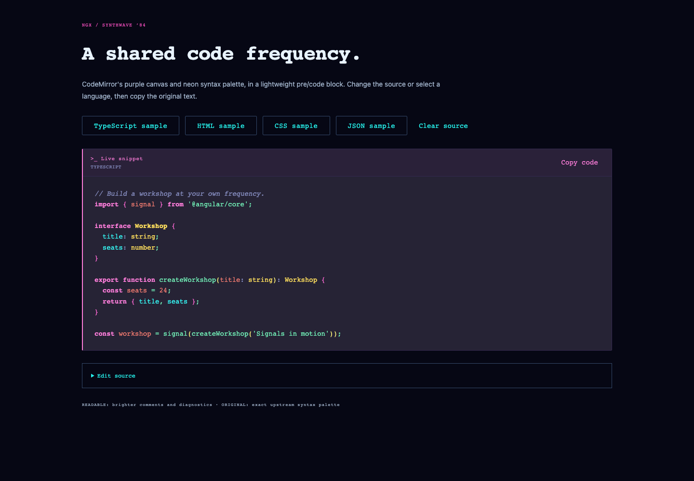

# Synthwave code blocks

Code presentation uses the palette and semantic tag rules from **@fsegurai/codemirror-theme-synthwave-84 6.0.4**, the version installed in the Shell when this feature was built. The MIT attribution is packaged in `styles/SYNTHWAVE-LICENSE.txt`.

The deep-purple background, white foreground, pink keywords, green strings/functions, yellow types and orange literals are shared across lightweight snippets and the CodeMirror comparison. The surrounding Neon/Neutral app palette does not change the code palette.

## Lightweight Angular snippets

```ts
import { NgxCodeBlock } from '@ngx-workshop/ui';
// Include NgxCodeBlock in your standalone component imports.
```

```html
<ngx-code-block
  [code]="source"
  label="workshop.ts"
  language="typescript"
  contrast="readable"
  [wrap]="false"
/>
```

| Input/output   | Contract                                                            |
| -------------- | ------------------------------------------------------------------- |
| `code`         | Required source string; never interpreted as HTML                   |
| `label`        | Header and accessible region label; default `Terminal`              |
| `language`     | `text` (default), `typescript`, `javascript`, `html`, `css`, `json` |
| `contrast`     | `readable` (default), `original`                                    |
| `wrap`         | `false` (default) scrolls long lines; `true` wraps them             |
| `copyComplete` | Emits clipboard success/failure as a boolean                        |

The component renders `<pre><code>` and escaped Angular text spans. Copy always uses the original source string, including whitespace, rather than reading styled markup. Empty snippets disable copy. Editing the source clears copied feedback.

Plain text does not load a syntax parser. A selected language loads the standalone Lezer highlighter/parser on demand; this renderer has **no CodeMirror view/runtime dependency**. The parser packages are production dependencies, but CodeMirror and the upstream theme package are development-only dependencies of the comparison demo.
Source changes replace pending results; stale parser work cannot overwrite newer text. Parser-load failures leave plain text readable. Snippets over **50,000 UTF-16 code units** deliberately skip parsing without truncating their display or clipboard source.

## Native pre/code without a component

Include the shared global theme once:

```scss
@use '@ngx-workshop/ui/theme' as ngx;
@include ngx.theme();
```

Native `pre` elements with a direct `code` child automatically inherit the same Synthwave presentation:

```html
<pre tabindex="0" role="region" aria-label="Install command"><code>{{ command }}</code></pre>
```

The optional `ngx-code` class also styles a standalone `pre`. Inline prose code is not changed. Native markup does not get automatic highlighting or a copy button; pre-tokenized content can use the `ngx-syntax-*` classes (keyword, string, type, comment, property, literal and others). The `code-styles()` Sass mixin is available separately when composing a custom global theme; `theme()` already includes it.

## Original and readable contrast

`original` restores the exact upstream syntax colors. Upstream comment/meta/gutter color `#495495` has about 2.17:1 contrast on the `#262335` canvas, and diagnostic red `#fe4450` is just under 4.5:1.

The default `readable` variant retains the palette while raising comments/meta to the existing palette color `#848bbd`, and slightly brightens diagnostic red to `#ff5360`. The CodeMirror comparison applies the same readable adjustments to syntax and gutter text. The original variant remains available for exact visual matching.

```html
<ngx-code-block [code]="source" language="typescript" contrast="original" />
<pre data-code-contrast="original"><code>{{ source }}</code></pre>
```

## Existing CodeMirror use

Continue using the actual upstream package for editor views:

```ts
import { synthwave84 } from '@fsegurai/codemirror-theme-synthwave-84';
// Add synthwave84 to your existing EditorState extensions.
```

No production editor wrapper is introduced by this library. Storybook's **CodeMirror parity** page creates a real read-only CodeMirror view using that package and the same code sample as NgxCodeBlock. The demo adds the shared semantic highlight classes through CodeMirror's public HighlightStyle API so readable/original contrast can be compared consistently. Its module loads only when the comparison is rendered and its EditorView is destroyed with the demo.

## Token contract

| Token                                            | Default/meaning                                             |
| ------------------------------------------------ | ----------------------------------------------------------- |
| `--ngx-code-background`                          | `#262335`, code canvas                                      |
| `--ngx-code-header`                              | `#2a2139`, snippet header                                   |
| `--ngx-code-foreground`                          | `#ffffff`                                                   |
| `--ngx-code-border`, `--ngx-code-selection`      | `#34294f`                                                   |
| `--ngx-code-accent`, `--ngx-code-pink`           | `#ff7edb`                                                   |
| `--ngx-code-green`                               | `#72f1b8`                                                   |
| `--ngx-code-yellow`                              | `#fede5d`                                                   |
| `--ngx-code-orange`                              | `#f97e72`                                                   |
| `--ngx-code-purple`                              | `#b893ce`                                                   |
| `--ngx-code-blue`                                | `#36f9f6`                                                   |
| `--ngx-code-muted`, `--ngx-code-comment`         | `#848bbd` in readable mode                                  |
| `--ngx-code-comment-original`                    | `#495495`                                                   |
| `--ngx-code-red`                                 | `#ff5360` readable diagnostic red                           |
| `--ngx-code-red-original`                        | `#fe4450`                                                   |
| `--ngx-code-glow-pink`, `--ngx-code-glow-yellow` | `#ff6ad5`, `#f3e877`                                        |
| `--ngx-code-font`                                | JetBrains Mono, Consolas, monospace; no remote font request |

Override tokens at the root or on a snippet when composing another code theme. Original mode specifically selects the `*-original` comment/red tokens.

Storybook includes the live snippet lab, actual CodeMirror comparison, five language examples, wrapping, empty/escaped source, large plain fallback and native markup. Automated contrast checks target readable mode; original mode intentionally preserves the upstream low-contrast colors.




