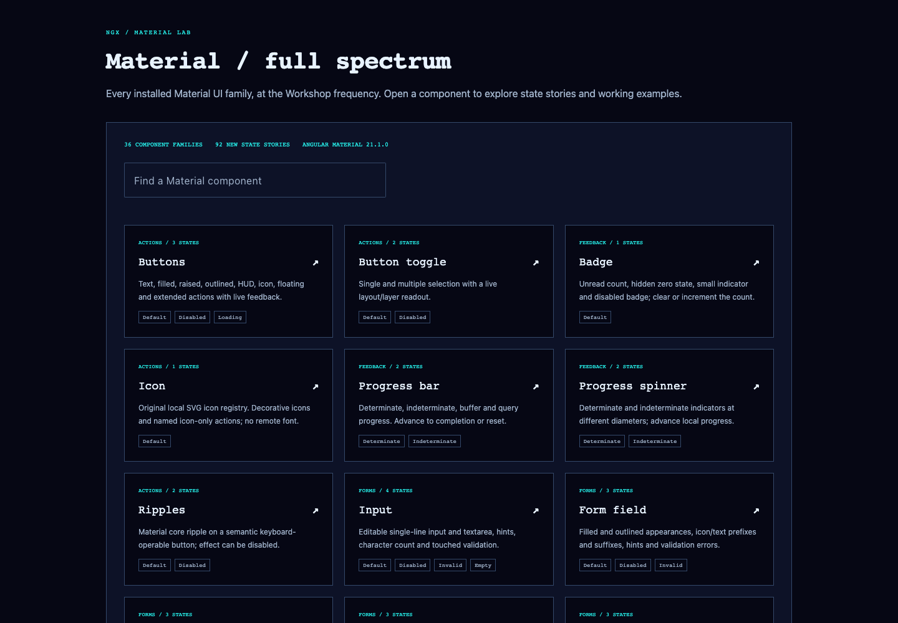
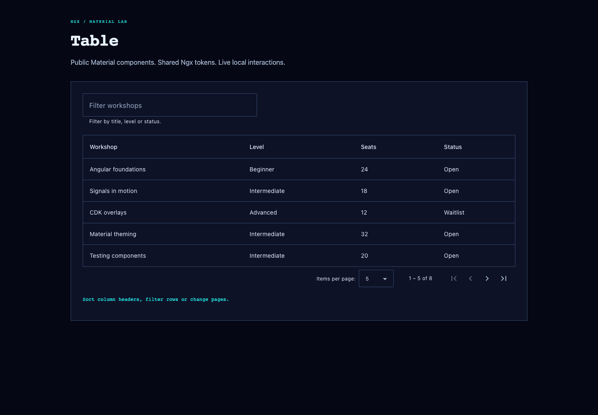

# Angular Material coverage

The catalog targets the installed **21.1.0** UI entry points. These are development-only consumers of the shared theme, not exported wrapper components.

| Component                                                                                              | Stories/states                               | Interactive coverage                                                                                                            |
| ------------------------------------------------------------------------------------------------------ | -------------------------------------------- | ------------------------------------------------------------------------------------------------------------------------------- |
| [Buttons](http://localhost:6006/?path=/story/material-actions-buttons--default)                        | Default, Disabled, Loading                   | Text, filled, raised, outlined, HUD, icon, floating and extended actions with live feedback.                                    |
| [Button toggle](http://localhost:6006/?path=/story/material-actions-button-toggle--default)            | Default, Disabled                            | Single and multiple selection with a live layout/layer readout.                                                                 |
| [Badge](http://localhost:6006/?path=/story/material-feedback-badge--default)                           | Default                                      | Unread count, hidden zero state, small indicator and disabled badge; clear or increment the count.                              |
| [Icon](http://localhost:6006/?path=/story/material-actions-icon--default)                              | Default                                      | Original local SVG icon registry. Decorative icons and named icon-only actions; no remote font.                                 |
| [Progress bar](http://localhost:6006/?path=/story/material-feedback-progress-bar--determinate)         | Determinate, Indeterminate                   | Determinate, indeterminate, buffer and query progress. Advance to completion or reset.                                          |
| [Progress spinner](http://localhost:6006/?path=/story/material-feedback-progress-spinner--determinate) | Determinate, Indeterminate                   | Determinate and indeterminate indicators at different diameters; advance local progress.                                        |
| [Ripples](http://localhost:6006/?path=/story/material-actions-ripples--default)                        | Default, Disabled                            | Material core ripple on a semantic keyboard-operable button; effect can be disabled.                                            |
| [Input](http://localhost:6006/?path=/story/material-forms-input--default)                              | Default, Disabled, Invalid, Empty            | Editable single-line input and textarea, hints, character count and touched validation.                                         |
| [Form field](http://localhost:6006/?path=/story/material-forms-form-field--default)                    | Default, Disabled, Invalid                   | Filled and outlined appearances, icon/text prefixes and suffixes, hints and validation errors.                                  |
| [Autocomplete](http://localhost:6006/?path=/story/material-forms-autocomplete--default)                | Default, Disabled, NoResults                 | Type to filter local topics and select an overlay option; empty results are explicit.                                           |
| [Checkbox](http://localhost:6006/?path=/story/material-forms-checkbox--default)                        | Default, Disabled, Indeterminate             | Checked/unchecked, disabled and indeterminate controls with live state.                                                         |
| [Radio button](http://localhost:6006/?path=/story/material-forms-radio-button--default)                | Default, Disabled, Unselected                | Single selection, an unavailable option, unselected state and group disabled state.                                             |
| [Select](http://localhost:6006/?path=/story/material-forms-select--default)                            | Default, Disabled, Invalid, Empty            | Single/multiple selection, grouped options, disabled option and required validation.                                            |
| [Slider](http://localhost:6006/?path=/story/material-forms-slider--default)                            | Default, Disabled                            | Discrete seat capacity with ticks and two-thumb duration range, both keyboard operable.                                         |
| [Slide toggle](http://localhost:6006/?path=/story/material-forms-slide-toggle--default)                | Default, Disabled                            | On/off notification preference plus a required disabled toggle.                                                                 |
| [Chips](http://localhost:6006/?path=/story/material-forms-chips--default)                              | Default, Disabled, Empty                     | Selectable chips plus an editable tag grid with keyboard addition and accessible remove actions.                                |
| [Datepicker](http://localhost:6006/?path=/story/material-date-and-time-datepicker--default)            | Default, DateRange, Disabled, Invalid, Empty | Native-date calendar, date range, constrained month, empty/invalid/disabled states. Fixed October 2026 demo dates.              |
| [Timepicker](http://localhost:6006/?path=/story/material-date-and-time-timepicker--default)            | Default, Disabled, Invalid, Empty            | Native-date time dropdown in 30-minute intervals, constrained to 09:00–17:00.                                                   |
| [Menu](http://localhost:6006/?path=/story/material-navigation-menu--default)                           | Default, Disabled                            | Nested export menu, disabled action and selection feedback. Escape restores trigger focus.                                      |
| [Sidenav](http://localhost:6006/?path=/story/material-navigation-sidenav--closed)                      | Closed, Open                                 | Contained navigation drawer with side/overlay mode switch and working navigation state.                                         |
| [Toolbar](http://localhost:6006/?path=/story/material-navigation-toolbar--default)                     | Default, DisabledAction                      | Top-level title, navigation toggle and notification action, with local feedback.                                                |
| [Tabs](http://localhost:6006/?path=/story/material-navigation-tabs--default)                           | Default, DisabledTab                         | Keyboard-operable tab group, selected-tab readout and optional disabled analytics tab.                                          |
| [Card](http://localhost:6006/?path=/story/material-layout-card--default)                               | Default, DisabledActions, Loading            | Outlined and raised cards with title/subtitle, content, actions, footer and loading state.                                      |
| [Divider](http://localhost:6006/?path=/story/material-layout-divider--default)                         | Default                                      | Full-width and inset dividers in a list, plus vertical separators.                                                              |
| [Expansion panel](http://localhost:6006/?path=/story/material-layout-expansion-panel--collapsed)       | Collapsed, Expanded, DisabledPanel           | Multi accordion with expand/collapse-all, action row and an unavailable panel.                                                  |
| [Grid list](http://localhost:6006/?path=/story/material-layout-grid-list--default)                     | Default, Compact                             | Tile spans and gutters in two-/three-column layouts.                                                                            |
| [List](http://localhost:6006/?path=/story/material-layout-list--default)                               | Default, Disabled, Empty                     | Selection list with icons, title/supporting lines, unavailable resource and empty state. Navigation lists appear under Sidenav. |
| [Stepper](http://localhost:6006/?path=/story/material-layout-stepper--linear)                          | Linear, Vertical, Prefilled                  | Linear validation-gated wizard, back/next, local completion and reset; horizontal/vertical layouts.                             |
| [Dialog](http://localhost:6006/?path=/story/material-overlays-dialog--default)                         | Default, Destructive, DisabledTrigger        | Confirm/cancel dialog returns results, with a separate destructive specimen and keyboard focus management.                      |
| [Bottom sheet](http://localhost:6006/?path=/story/material-overlays-bottom-sheet--default)             | Default, DisabledTrigger                     | Action sheet with Markdown/JSON results and dismissal behavior.                                                                 |
| [Snackbar](http://localhost:6006/?path=/story/material-overlays-snackbar--success)                     | Success, Retry                               | Persistent actionable notifications with Undo/Retry and manual dismissal; no short auto-dismiss timeout.                        |
| [Tooltip](http://localhost:6006/?path=/story/material-overlays-tooltip--default)                       | Default, Disabled, Below                     | Hover and keyboard-focus hints, placement controls, disabled hint and Escape dismissal.                                         |
| [Table](http://localhost:6006/?path=/story/material-data-table--default)                               | Default, Empty, Loading                      | Local workshop rows with real filtering, sorting and pagination, plus empty/loading states.                                     |
| [Sort header](http://localhost:6006/?path=/story/material-data-sort-header--default)                   | Default, Disabled                            | Sortable title/level/seat headers with live direction feedback and sorting disabled state.                                      |
| [Paginator](http://localhost:6006/?path=/story/material-data-paginator--default)                       | Default, Disabled, Empty                     | First/last, previous/next, page-size selection and empty/disabled states.                                                       |
| [Tree](http://localhost:6006/?path=/story/material-data-tree--default)                                 | Default, Empty                               | Modern childrenAccessor resource tree, nested expansion, expand/collapse-all and leaf selection.                                |

All 36 public UI families are covered, including Material core ripples and the native timepicker. Package helpers/date adapters, schematics and prebuilt themes are not separate UI families.

Storybook controls expose only the states and inputs applicable to each component. Switching a form state resets its example values so default, invalid, empty and disabled specimens remain reproducible. Only the state stories listed above are claimed; exhaustive combinations of every Material input are outside this catalog.

Examples use local in-memory data and ephemeral state. Date examples deliberately use October 2026 to remain repeatable. Icon examples register original local SVGs; no icon/font CDN is required.

Use the global theme toolbar to compare Neon and Neutral. Open overlays after selecting a palette to inspect inherited theme tokens. Browser tests exercise actual filtering/sorting/pagination, selection, validation, focus and dismissal. Automated accessibility checks cover representative initial and overlay states, not all possible Material configurations.

The Material buttons example now includes the shared NgxButton directive. Explore **Components → Button → Interaction lab** for its shape/surface comparisons, motion variants and native keyboard/link/submit demonstrations. This does not replace the direct Material button variants in this catalog.
