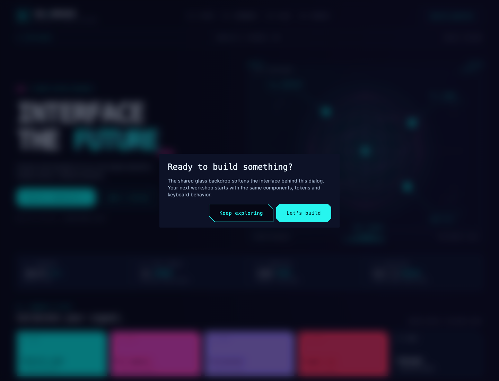
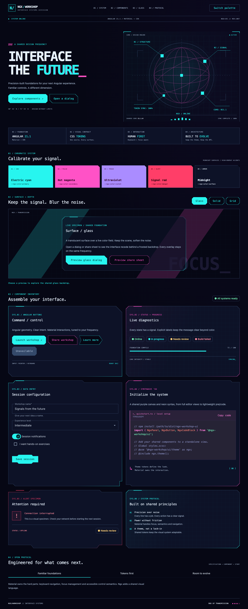

# Glass overlay backdrops

The shared `theme()` mixin now gives active **CDK Overlay backdrops** a frosted-glass treatment: a translucent canvas tint, 12px blur and gentle saturation. Dialogs, bottom sheets and connected overlays such as select/menu popups inherit it automatically.

```scss
@use '@tmdjr/ngx-workshop-design-system/theme' as ngx;
@include ngx.theme();
```

`overlay-styles()` is separately exported for custom theme composition; do not include it twice when using `theme()`.

| Token                               | Default                     | Purpose                                            |
| ----------------------------------- | --------------------------- | -------------------------------------------------- |
| `--ngx-overlay-backdrop-tint`       | Canvas color at 55% opacity | Glass tint, inherited from the current app palette |
| `--ngx-overlay-backdrop-blur`       | `12px`                      | Amount of background blur                          |
| `--ngx-overlay-backdrop-saturation` | `120%`                      | Background color saturation                        |
| `--ngx-overlay-backdrop-fallback`   | Canvas color                | Opaque fallback                                    |

Override these at the document root so body-level overlay containers inherit them:

```scss
html {
  --ngx-overlay-backdrop-blur: 16px;
  --ngx-overlay-backdrop-saturation: 110%;
}
```

The backdrop itself performs the filtering; foreground overlay content remains clear and readable. Connected overlays' normally transparent light-dismiss backdrops become visibly frosted while active. Existing click/Escape dismissal, focus traps, scroll strategy and stacking remain owned by Material/CDK.

Browsers without backdrop filtering, and users requesting reduced transparency, get the opaque fallback. Forced-colors mode uses system Canvas and disables filtering. Reduced-motion behavior stays with CDK and the existing global theme.

No backdrop is created for overlays that do not normally use one: tooltips and snackbars do not suddenly dim or block the page. Material drawer/sidenav backdrops have a separate implementation and are not targeted with private selectors.

Workshop Frequency's **Surface + depth** section switches its preview panel between glass, solid and grid, and opens a real dialog/share sheet over the frosted scene. Its hero/actions now use the shared button directive; component panels demonstrate different shapes, and the developer block uses highlighted Synthwave TypeScript.




