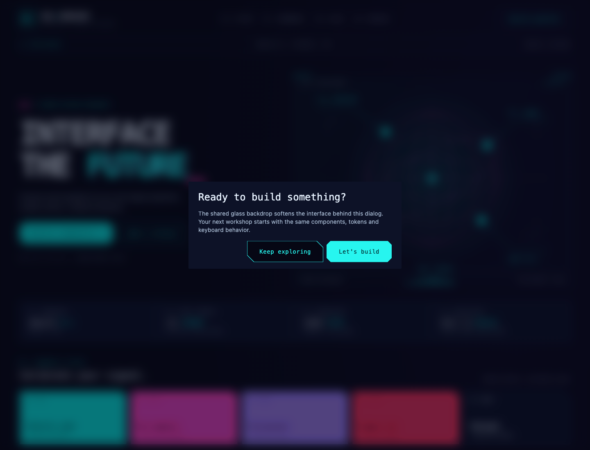
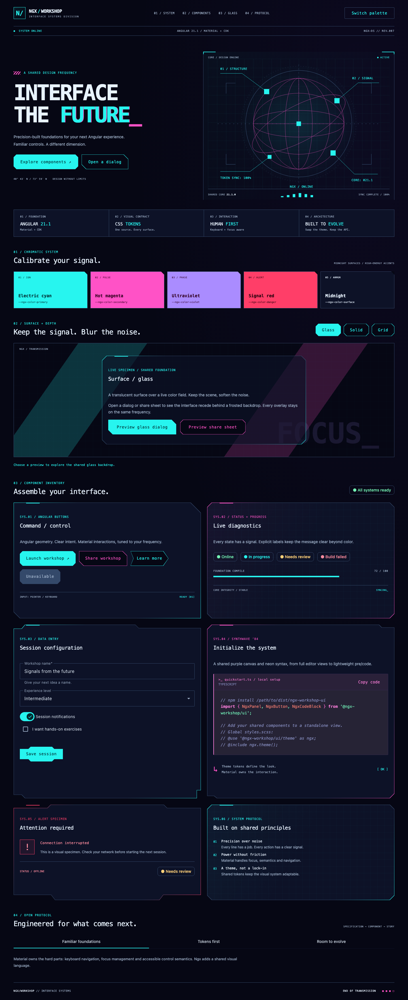

# Overlay styling and glass backdrops

The shared `theme()` mixin now gives active **CDK Overlay backdrops** a frosted-glass treatment: a translucent dark scrim, 12px blur and gentle saturation. Dialogs and bottom sheets inherit it automatically. Menus and selects retain their transparent, unfiltered dismissal backdrops.

```scss
@use '@tmdjr/ngx-workshop-design-system/theme' as ngx;
@include ngx.theme();
```

`overlay-styles()` is separately exported for custom theme composition; do not include it twice when using `theme()`.

| Token                               | Default                    | Purpose                                          |
| ----------------------------------- | -------------------------- | ------------------------------------------------ |
| `--ngx-overlay-backdrop-color`      | `#060714`                  | Dark scrim color, independent of the page canvas |
| `--ngx-overlay-backdrop-tint`       | Scrim color at 55% opacity | Glass tint in both light and dark themes         |
| `--ngx-overlay-backdrop-blur`       | `12px`                     | Amount of background blur                        |
| `--ngx-overlay-backdrop-saturation` | `120%`                     | Background color saturation                      |
| `--ngx-overlay-backdrop-fallback`   | Scrim color                | Opaque dark fallback                             |

Override these at the document root so body-level overlay containers inherit them:

```scss
html {
  --ngx-overlay-backdrop-blur: 16px;
  --ngx-overlay-backdrop-saturation: 110%;
}
```

The backdrop itself performs the filtering; foreground overlay content remains clear and readable. The public `cdk-overlay-transparent-backdrop` hook is excluded from every visual rule, including reduced-transparency and forced-colors rules. Menu/select light-dismiss backdrops remain invisible and interactive; opening a dropdown does not blur or dim the page. Existing click/Escape dismissal, focus traps, scroll strategy and stacking remain owned by Material/CDK.

Browsers without backdrop filtering, and users requesting reduced transparency, get the opaque dark fallback. Forced-colors mode uses system Canvas and disables filtering. Reduced-motion behavior stays with CDK and the existing global theme.

No backdrop is created for overlays that do not normally use one: tooltips and snackbars do not suddenly dim or block the page. Material drawer/sidenav backdrops have a separate implementation and are not targeted with private selectors.

Workshop Frequency's **Surface + depth** section switches its preview panel between glass, solid and grid, and opens a real dialog/share sheet over the frosted scene. Its hero/actions now use the shared button directive; component panels demonstrate different shapes, and the developer block uses highlighted Synthwave TypeScript.





## Shared portal policy

`theme()` also includes `overlay-policy()`. The additive policy centralizes these
consumer-owned class contracts:

| Class                        | Apply through                                               | Shared treatment                                                                     |
| ---------------------------- | ----------------------------------------------------------- | ------------------------------------------------------------------------------------ |
| `ngx-design-system-overlay`  | Public `panelClass`, `matTooltipClass`, or menu panel class | Semantic text color/body font; inherited document color scheme                       |
| `ngx-design-system-backdrop` | Public `backdropClass`                                      | Same token-based glass/fallback treatment as the existing global CDK backdrop policy |
| `ngx-select-panel`           | Select `panelClass` only                                    | Retains the terminal fade frame until Material detaches the panel                    |

It does not replace Material surfaces, palettes, focus management, positioning,
stacking, values, scroll strategy, dismissal or animation duration/keyframes.
Existing `overlay-styles()` retains its global CDK backdrop contract.
The select workaround is opt-in and does not target other animations or unmarked
controls. `Ngx` component imports are not required for these CSS class markers.

Use the ordinary native Material API:

```html
<mat-select panelClass="ngx-design-system-overlay ngx-select-panel">
  <mat-option value="admin">Admin</mat-option>
  <mat-option value="workshop">Workshop</mat-option>
</mat-select>
```

```ts
this.dialog.open(MyDialog, {
  panelClass: 'ngx-design-system-overlay',
  backdropClass: 'ngx-design-system-backdrop',
});
```

Other owned classes may coexist in `panelClass`. Use the same overlay class on
bottom sheets, menus, tooltips and snackbars via their public class configuration.
Transparent dismissal backdrops are excluded even when also marked with the scoped
backdrop class; they never acquire blur, scrim or forced-color opacity from this policy.

### Select closing behavior

Material 21.1.0 sets an inline animation shorthand while closing. Its default
fill-mode allows the completed fade to revert to full opacity before the overlay
is detached. `ngx-select-panel` applies only `animation-fill-mode: forwards
!important` to the consumer-marked panel. Importance is required to override the
inline shorthand. Material still owns the animation and its `animationend` cleanup.
Selection, outside click and Escape follow the same path. Opening uses Material's
normal entrance again, so a previously closed select does not remain invisible.
Multiple selection keeps its normal behavior: choosing an option does not close it.

The policy adds no motion or JavaScript. Reduced-motion/no-animation handling stays
with Material and the existing theme. There are no private Material DOM selectors
or animation names in shipped policy CSS. Tests identify the installed native exit
animation solely to inspect the frame immediately before native detachment.

### Custom themes and federation

Load `theme()` once at the document root. Custom compositions that already supply
semantic tokens and Material theme roles can include the policy separately:

```scss
@use '@tmdjr/ngx-workshop-design-system/theme' as ngx;
@include ngx.overlay-policy();
```

Include it globally. Encapsulated component styles cannot style body-level portals;
federated remotes generally rely on their host shell's global stylesheet. Do not
include it again if `theme()` already emits it. `overlay-policy()` alone does not
emit tokens, Material palettes, generic CDK backdrop styles or a forced dark scheme.
Use existing `overlay-styles()` separately if a custom theme also wants the generic
CDK backdrop treatment.

Document-level `data-ngx-theme` and semantic tokens must reach overlays. Material
21.1.0 can render selects as inline native popovers, while the public CDK
`OVERLAY_DEFAULT_CONFIG` with `usePopover: false` uses a detached overlay container.
Both receive the class policy. The component does not relocate overlays or copy
local theme state. Root-scoped themes keep both modes consistent.

When adopting after publication, remove repeated portal font/color rules and
hardcoded `color-scheme: dark` declarations. Remove app-owned select fill-mode
rules only after the shell emits this policy and those selects have the new
`ngx-select-panel` marker. Component-specific layout and extra panel classes stay
with the app. Existing `.ngx-design-system` page scopes are outside this overlay policy.

Storybook **Foundations → Overlay policy** includes Native overlays and Container
overlays, single/multiple and unmarked selects, a dialog, sheet, menu, tooltip and
snackbar. Compare document palettes and keyboard dismissal. Browser regressions
check final frames, values, focus, transparent backdrops and preference fallbacks.
No consumer source migration or package publication accompanies this producer change.
