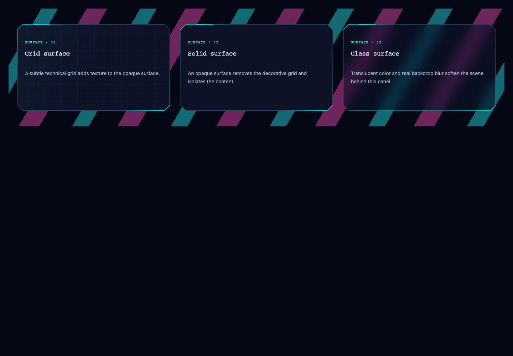
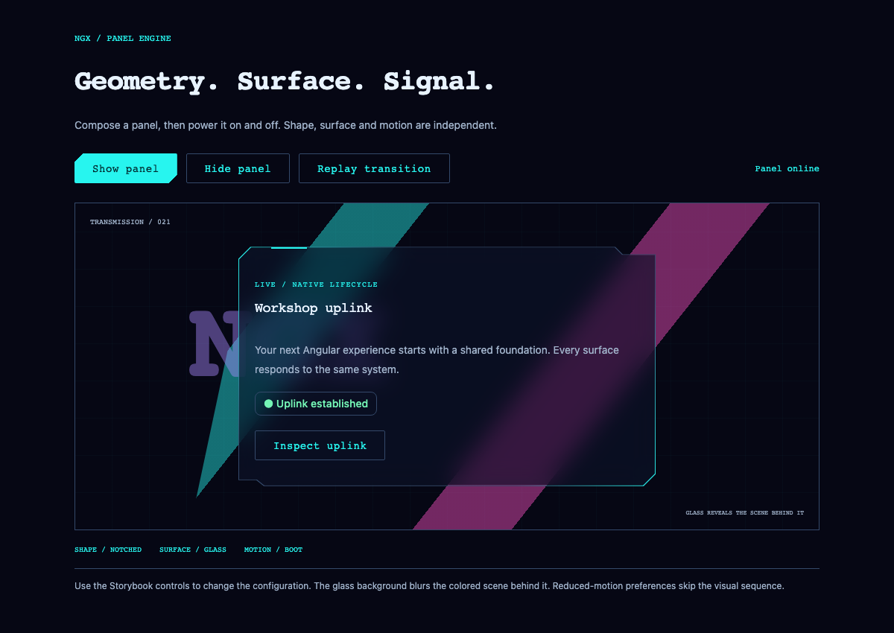

# Panel shapes, surfaces and motion

`NgxPanel` keeps Material card semantics and projected content while making the frame, surface and lifecycle motion independent.

| Input        | Values                                                 | Default           |
| ------------ | ------------------------------------------------------ | ----------------- |
| `heading`    | Required string                                        | —                 |
| `eyebrow`    | String                                                 | `Workshop module` |
| `tone`       | `primary`, `secondary`, `danger`                       | `primary`         |
| `shape`      | `notched`, `chamfered`, `beveled`, `stepped`, `banner` | `notched`         |
| `background` | `grid`, `solid`, `glass`                               | `grid`            |
| `motion`     | `none`, `boot`, `glitch`, `hologram`                   | `none`            |

```ts
import { NgxPanel } from '@tmdjr/ngx-workshop-design-system';
// Include NgxPanel in the standalone component imports.
```

```html
@if (showPanel()) {
<ngx-panel
  heading="Workshop uplink"
  eyebrow="CHANNEL / 021"
  shape="stepped"
  background="glass"
  motion="boot"
  tone="primary"
>
  <p>Your session is ready.</p>
  <div ngxPanelActions>
    <button mat-stroked-button>Inspect uplink</button>
  </div>
</ngx-panel>
}
```

Import Material's button module when using the projected button above. `showPanel` is a signal owned by the consuming view.

## Shape selection

- **Notched:** the original asymmetric cut frame; existing consumers keep their silhouette.
- **Chamfered:** four cut corners, suitable for consoles and tall instrument panels.
- **Beveled:** large opposing diagonal cuts.
- **Stepped:** top tab and lower edge steps, inspired by modular HUD housings.
- **Banner:** raised top tab and centered lower extension, suitable for wide readouts.

Content determines the panel height. Shapes adapt to the host's dimensions; none impose a fixed aspect ratio.
Only decorative layers are clipped. Projected controls and focus outlines stay unclipped.

## Backgrounds

**Grid** includes the existing opaque technical grid. **Solid** is an opaque `--ngx-color-surface` fill without the grid.
A local token override such as `style="--ngx-color-surface: #102738"` customizes the solid color without another component API.

**Glass** uses a translucent surface with real `backdrop-filter` blur and a separate hollow outline. Place glass over contrasting content or artwork to see the effect. The comparison and transition stories include a colored scene for this purpose.
Browsers without backdrop-filter support get an opaque surface. A `prefers-reduced-transparency: reduce` preference also selects the opaque surface and disables blur.
Glass contrast depends on its backdrop; choose enough opacity for the content behind your particular panel. The demo scene is covered by automated accessibility checks, not arbitrary consumer backdrops.

## Intro and outro

Native Angular `animate.enter` / `animate.leave` host bindings add component-local CSS classes on insertion and removal.
No animation provider or `@angular/animations` DSL setup is required.

- **Boot:** powers up from a horizontal line with a one-pass scan; powers down to a line.
- **Glitch:** short stepped position/skew offsets with a monotonic fade. No flashing or looping flicker.
- **Hologram:** a softened perspective reveal and blurred dissolve.
- **None:** immediate insertion/removal, the compatible default.

An `@if` directly containing the panel triggers both phases. Angular retains the element until the outro finishes; consumers should not remove it manually or replace the surrounding DOM outside Angular.
Removing an entire ancestor tree can bypass descendant lifecycle animations. Keep the visibility boundary directly on `ngx-panel` when its outro must finish.
Changing a visual input does not replay the intro. Remove/reinsert the panel to replay it; the Storybook transition lab does this after actual DOM removal, without a guessed delay.
Leaving panels become inert and ignore pointer interaction. Consumers must manage focus when removing a panel containing the active control; the demo keeps its show/hide/replay controls outside the removed panel.
Reduced-motion preferences shorten both phases to 1ms and suppress the scanning line, even if the global Ngx theme is not included.

## Tokens

| CSS token                    | Default          | Purpose                                |
| ---------------------------- | ---------------- | -------------------------------------- |
| `--ngx-panel-enter-duration` | `480ms`          | Intro duration                         |
| `--ngx-panel-leave-duration` | `320ms`          | Outro duration                         |
| `--ngx-panel-blur`           | `16px`           | Glass backdrop blur                    |
| `--ngx-panel-glass-opacity`  | `65%`            | Surface contribution in glass fill     |
| `--ngx-cut`                  | `16px`           | Corner cut depth for applicable shapes |
| `--ngx-frame-shape`          | Original polygon | Default notched frame/surface polygon  |

Duration, blur and opacity tokens may be overridden globally or on one panel. Reduced-motion behavior takes precedence over duration overrides.
The other preset shapes have component-owned polygon geometry. If you replace the default polygon contract entirely, validate the built-in glass outline too: its inset stroke follows the built-in shape vertices, not arbitrary external polygons.

Try **Components → Panel → Shapes**, **Backgrounds**, and **Transition lab** in Storybook.





## Header content

Place metadata and quick actions in an element marked `ngxPanelHeader` to project
it alongside the heading. Body content stays unmarked; `ngxPanelActions` continues
to project into the footer. Existing panels need no changes. Header content wraps
below the heading when space is limited; keep controls labelled and allow your
projected layout to wrap as well.

```html
<ngx-panel heading="Dashboard" eyebrow="REMOTE CONFIGURATION">
  <div ngxPanelHeader>
    <span>ID remote-021</span>
    <button mat-stroked-button>Preview remote</button>
  </div>
  <p>Configuration fields</p>
  <div ngxPanelActions><button mat-flat-button>Save changes</button></div>
</ngx-panel>
```
